# Guia de funcionalidades do AgenDoc

Tutorial do que o AgenDoc já faz, tela por tela, para quem está chegando no grupo.

- **Situação em 16/11/2026:** MVP (cadastro, login e chat com IA), **Parte 1: Clínicas e agendamento** (no ar desde 09/11/2026) e **Parte 2: E-mail** (no ar desde 15/11/2026). Próximos passos no [roadmap](../roadmap.md).
- **Onde testar:** https://agendoc.duckdns.org (veja [Como testar](#como-testar)).
- **Sobre as imagens:** foram tiradas do app rodando localmente, com os dados de demonstração. As telas do paciente são de celular (390 px, em 3x) e as do painel da clínica são de computador (1440 px, em 2x). Os e-mails foram capturados no Mailpit, a caixa de e-mail de teste do ambiente local. Clique em qualquer imagem para abrir em tamanho real.

> **Aviso:** o AgenDoc não substitui atendimento profissional. O assistente dá uma orientação inicial: não diagnostica nem prescreve. Todas as clínicas, médicos e avaliações são **fictícios** (por isso o selo "Dados de demonstração").

## Sumário

- [Visão geral](#visão-geral)
- [Como testar](#como-testar)
- **Paciente**
  1. [Cadastro, confirmação do e-mail e login](#1-cadastro-confirmação-do-e-mail-e-login)
  2. [Conversas com o assistente](#2-conversas-com-o-assistente)
  3. [Pré-triagem](#3-pré-triagem)
  4. [Emergência](#4-emergência)
  5. [Buscar clínicas](#5-buscar-clínicas)
  6. [Escolher clínica, dia e horário](#6-escolher-clínica-dia-e-horário)
  7. [Confirmar a consulta](#7-confirmar-a-consulta)
  8. [Consulta agendada ou aguardando a clínica](#8-consulta-agendada-ou-aguardando-a-clínica)
  9. [Minhas consultas](#9-minhas-consultas)
  10. [Adicionar à agenda e como chegar](#10-adicionar-à-agenda-e-como-chegar)
  11. [Remarcar](#11-remarcar)
  12. [Cancelar](#12-cancelar)
  13. [Avaliar a consulta](#13-avaliar-a-consulta)
  14. [Perfil](#14-perfil)
  15. [E-mails](#15-e-mails)
- **Clínica**
  1. [Agenda](#1-agenda)
  2. [Detalhe da consulta](#2-detalhe-da-consulta)
  3. [Solicitações](#3-solicitações)
  4. [Médicos](#4-médicos)
  5. [Horários de atendimento](#5-horários-de-atendimento)
  6. [Bloqueios](#6-bloqueios)
  7. [Dados da clínica](#7-dados-da-clínica)
  8. [Avaliações](#8-avaliações)
- [Regras importantes](#regras-importantes)
- [Bastidores](#bastidores)

## Visão geral

O AgenDoc ajuda a pessoa a entender **que tipo de médico procurar** e a **marcar a consulta** numa clínica perto dela. São dois perfis no mesmo app:

| Perfil | Onde | O que faz |
|---|---|---|
| **Paciente** | `/chat`, `/consultas`, `/perfil` (layout de celular) | Conversa com o assistente, recebe a pré-triagem, busca clínicas, marca, remarca, cancela e avalia consultas, e recebe os avisos e lembretes por e-mail |
| **Clínica** | `/clinica` (layout de computador, com menu lateral) | Vê a agenda, responde pedidos, cadastra médicos, horários e bloqueios, edita os dados e vê as avaliações |

Depois do login, quem é paciente vai para `/chat` (ou para `/confirmar-email`, se ainda não confirmou o e-mail) e quem é clínica vai para `/clinica`. Um perfil não acessa as telas do outro.

A jornada completa:

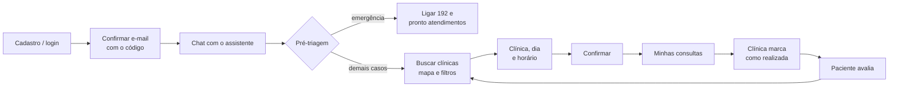

O status de uma consulta muda assim:

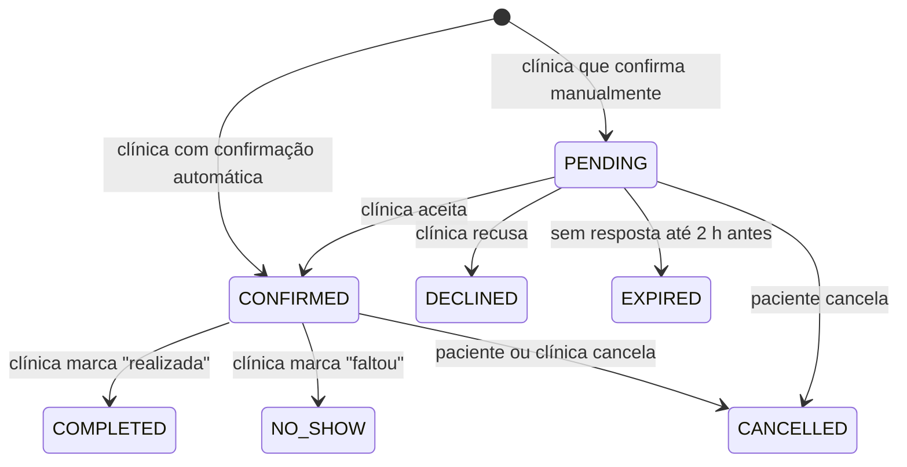

Na tela, os status aparecem como selos: **Confirmada**, **Aguardando a clínica**, **Sem resposta** (pedido atrasado), **Recusada**, **Expirou**, **Cancelada** ou **Cancelada pela clínica**, **Realizada**, **Faltou** e **Encerrada** (consulta cujo horário já passou e que a clínica ainda não marcou como realizada ou falta).

## Como testar

**Em produção** (https://agendoc.duckdns.org):

- **Paciente:** crie uma conta em "Criar conta" com um **e-mail que você consegue abrir**: o app só libera depois que você digita o código de 6 dígitos que chega nele (veja o [passo 1](#1-cadastro-confirmação-do-e-mail-e-login)).
- **Contas de teste de paciente:** `paciente1@demo.agendoc.dev`, `paciente2@demo.agendoc.dev` e `paciente3@demo.agendoc.dev`, já confirmadas. A senha é a mesma para as três e fica só no `.env` da VM; peça a quem cuida do deploy. Antes de apresentar, coloque o seu e-mail no campo **E-mail de envio** do [Perfil](#14-perfil): os e-mails dessas contas vão para lá, e ao marcar uma consulta chega na hora um lembrete de exemplo.
- **Clínica:** cada clínica de demonstração tem um login `<apelido>@demo.agendoc.dev`. A senha é a mesma para todas e fica só no `.env` da VM (não vai para o git); peça a quem cuida do deploy.

| Login | Clínica | Confirmação |
|---|---|---|
| `movimento@demo.agendoc.dev` | Clínica Movimento | automática |
| `coracao-paulista@demo.agendoc.dev` | Instituto Coração Paulista | automática |
| `dermavida@demo.agendoc.dev` | DermaVida | **manual** |
| `bem-viver@demo.agendoc.dev` | Clínica Bem Viver Pinheiros | automática |
| `neurocentro@demo.agendoc.dev` | NeuroCentro | automática |
| `otorrino-cia@demo.agendoc.dev` | Otorrino & Cia | **manual** |
| `visao-clara@demo.agendoc.dev` | Visão Clara Oftalmologia | automática |
| `respira@demo.agendoc.dev` | Respira Pneumologia | automática |
| `endosaude@demo.agendoc.dev` | EndoSaúde Vila Mariana | automática |
| `uroclinica@demo.agendoc.dev` | UroClínica Mariana | **manual** |
| `espaco-mulher@demo.agendoc.dev` | Espaço Mulher e Criança | automática |
| `mente-leve@demo.agendoc.dev` | Mente Leve Psiquiatria | automática |

Dica para a demonstração: marque uma consulta como paciente numa clínica **manual** (ex.: DermaVida, Dermatologista) e depois entre como a clínica para aceitar o pedido.

**Localmente:** siga o README de cada repositório ([`agendoc-api`](https://github.com/Agendoc/agendoc-api#rodando-localmente) e [`agendoc-web`](https://github.com/Agendoc/agendoc-web)). Sem chave de IA, o assistente roda em **modo simulação**: as respostas começam com "⚠️ Modo simulação" e a pré-triagem sai na terceira mensagem. Escrever `#emergencia` numa mensagem gera uma triagem de emergência. Algumas imagens deste guia foram tiradas nesse modo. O `docker compose` local também sobe o **Mailpit**, que segura todos os e-mails (nada sai de verdade) e mostra em http://localhost:8025. As contas de teste só são criadas com `DEMO_PATIENT_PASSWORD` definida, como os logins de clínica com `DEMO_CLINIC_PASSWORD`.

---

# Paciente

## 1. Cadastro, confirmação do e-mail e login

Na primeira tela a pessoa entra com e-mail e senha ou cria uma conta. O cadastro pede só **nome, e-mail e senha** (8 a 72 caracteres). Os campos de senha têm o botão do **olhinho**, que mostra ou esconde o que foi digitado (na imagem da direita a senha está visível).

  <a href="img/paciente/01-login.png">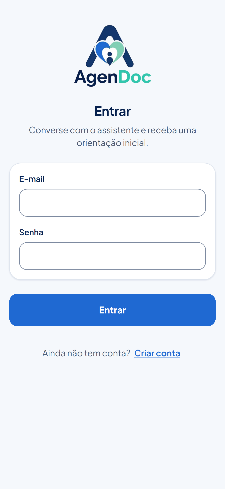</a>
  &nbsp;&nbsp;
  <a href="img/paciente/02-cadastro.png">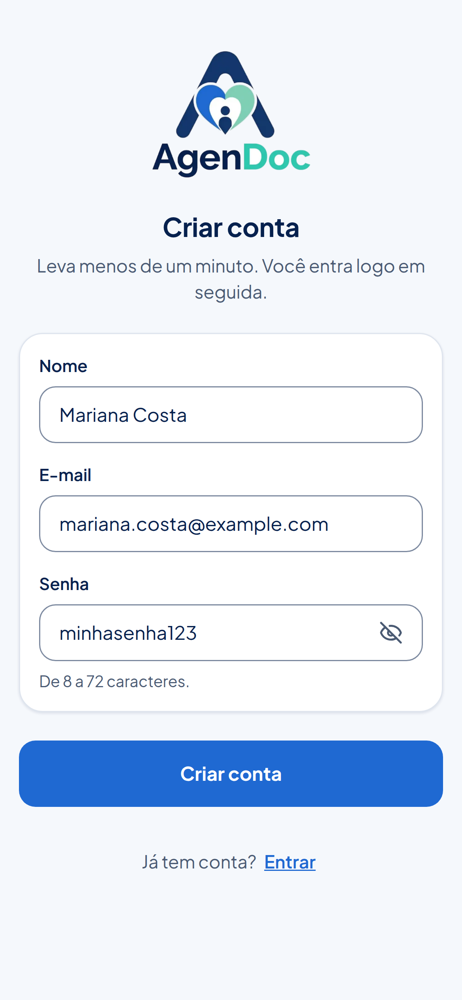</a>

A sessão fica num cookie do servidor (não há token no navegador). O botão **Sair** fica no topo das telas do paciente.

### Confirme seu e-mail

Depois do cadastro, a pessoa cai na tela **Confirme seu e-mail** (`/confirmar-email`) e recebe um e-mail com um **código de 6 dígitos** ([veja o e-mail](#15-e-mails)). Até digitar o código, o app fica **bloqueado**: chat, busca, consultas e perfil não abrem. Quem sair e entrar de novo sem ter confirmado volta para esta tela.

- O código vale **15 minutos** e aceita até **5 tentativas erradas**; depois disso é preciso pedir outro.
- **Reenviar código** manda um código novo (o anterior deixa de valer). Entre um pedido e outro há uma espera de 60 segundos, com contagem regressiva no botão, e o limite é de 5 por hora.
- O ícone de sair, embaixo, encerra a sessão (por exemplo, para quem digitou o e-mail errado e quer criar outra conta).

  <a href="img/paciente/29-confirmar-email.png">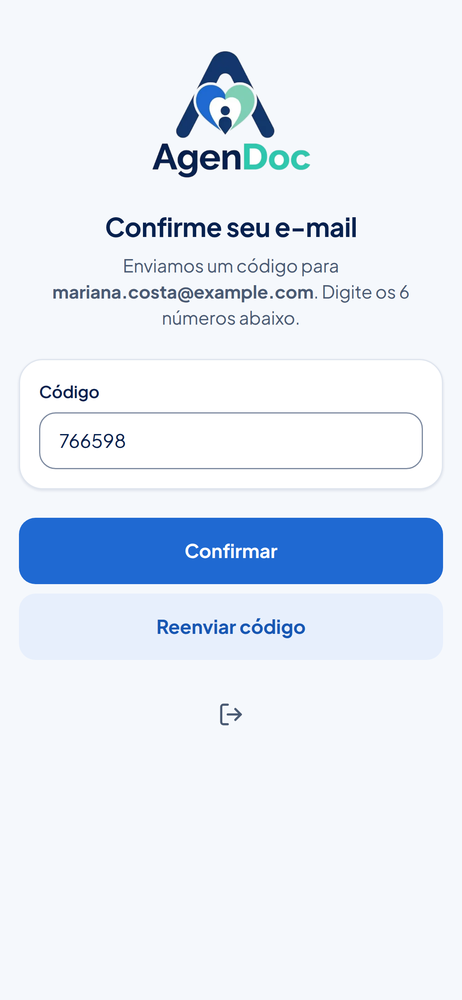</a>

Contas criadas antes da Parte 2, logins de clínica e as contas de teste já nascem confirmados. A confirmação vale só para pacientes.

### Esqueci a senha

O link **Esqueci a senha**, no login, abre `/esqueci-senha`, uma recuperação em **3 telas**, sempre por código (nunca por link):

1. **E-mail:** a pessoa informa o e-mail da conta. A resposta é sempre a mesma, exista a conta ou não, para não revelar quem tem cadastro.
2. **Código:** digita o código de 6 dígitos que chegou no e-mail. Dá para reenviar o código ou trocar o e-mail.
3. **Nova senha:** cria a nova senha e confirma (com o olhinho nos dois campos).

  <a href="img/paciente/30-esqueci-email.png">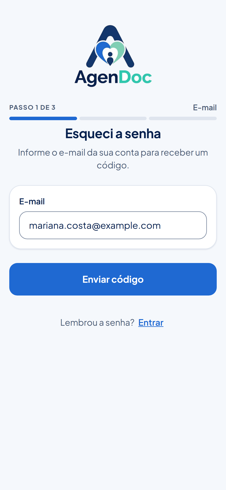</a>
  &nbsp;
  <a href="img/paciente/31-esqueci-codigo.png">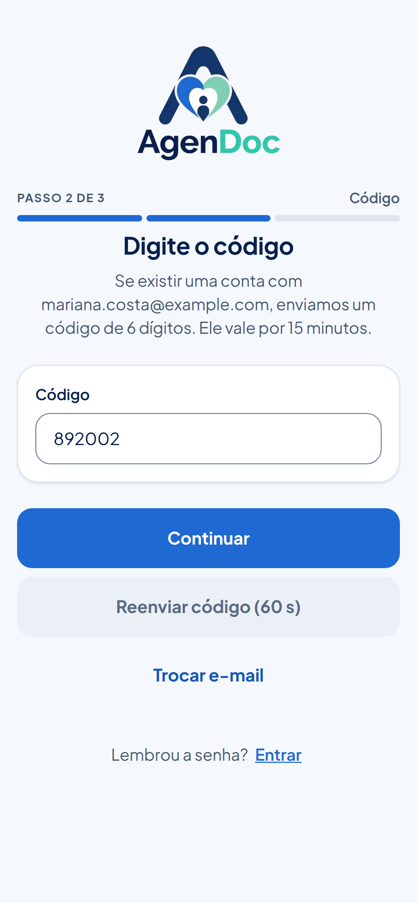</a>
  &nbsp;
  <a href="img/paciente/32-esqueci-nova-senha.png">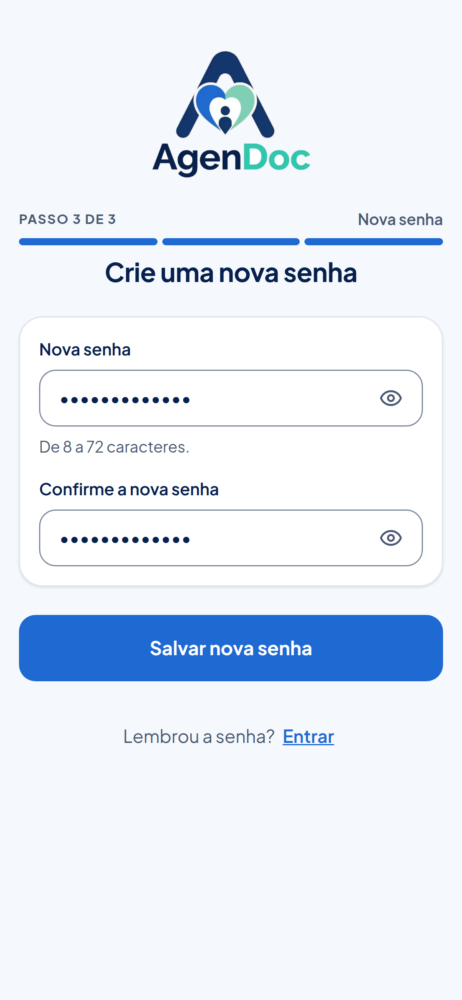</a>
  &nbsp;
  <a href="img/paciente/33-senha-alterada.png">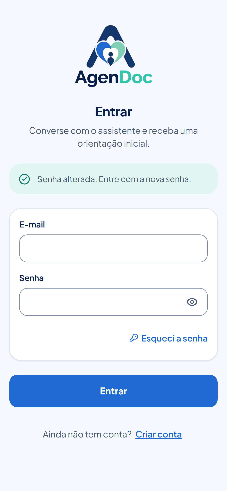</a>

No fim, a pessoa volta para o login (`/login?senha=alterada`) com a mensagem "Senha alterada. Entre com a nova senha." Não há login automático. Trocar a senha:

- encerra **todas as sessões abertas** da conta;
- marca o e-mail como confirmado (assim, quem teve o e-mail usado por outra pessoa num cadastro recupera a conta por aqui);
- manda o e-mail **"Sua senha foi alterada"**, com a orientação de procurar ajuda se não foi a pessoa.

O e-mail e o código nunca vão para a URL: recarregar a página volta para a primeira tela. Por segurança, qualquer falha na troca (código errado, vencido ou de uma conta que não existe) aparece só como "Código incorreto."

## 2. Conversas com o assistente

Em **Conversas** ficam todas as conversas da pessoa, da mais recente para a mais antiga. O **+** no topo (ou "Nova conversa") abre uma conversa nova.

  <a href="img/paciente/03-conversas-vazio.png">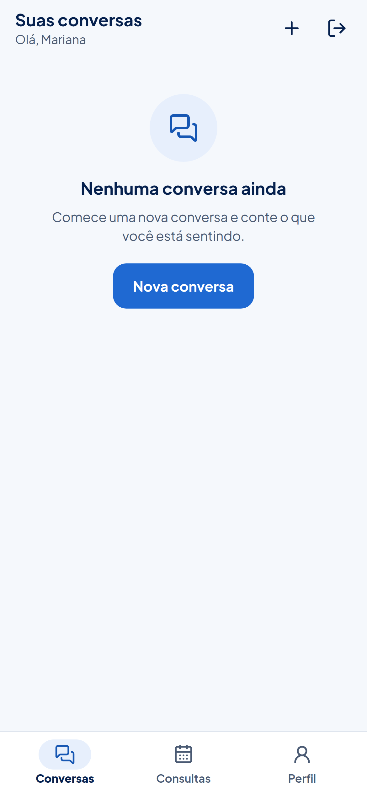</a>
  &nbsp;&nbsp;
  <a href="img/paciente/04-conversas-lista.png">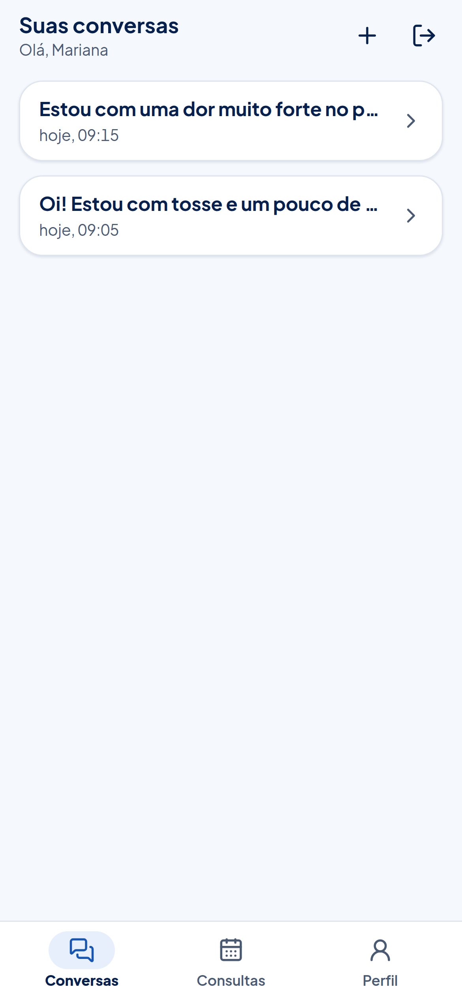</a>

No chat, a pessoa descreve o que está sentindo e o assistente faz perguntas, uma de cada vez. A resposta aparece **aos poucos** (streaming), como num chat de IA. O rodapé lembra sempre que o assistente não substitui atendimento profissional e mostra o 192. O ícone de lixeira apaga a conversa.

  <a href="img/paciente/05-chat-nova.png">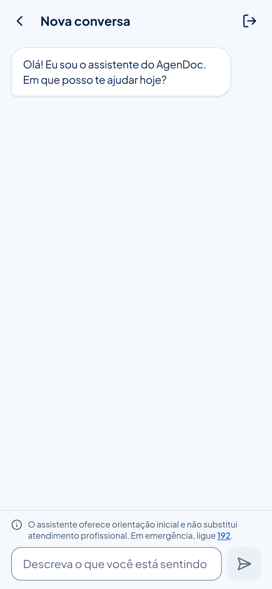</a>
  &nbsp;&nbsp;
  <a href="img/paciente/06-chat-conversa.png">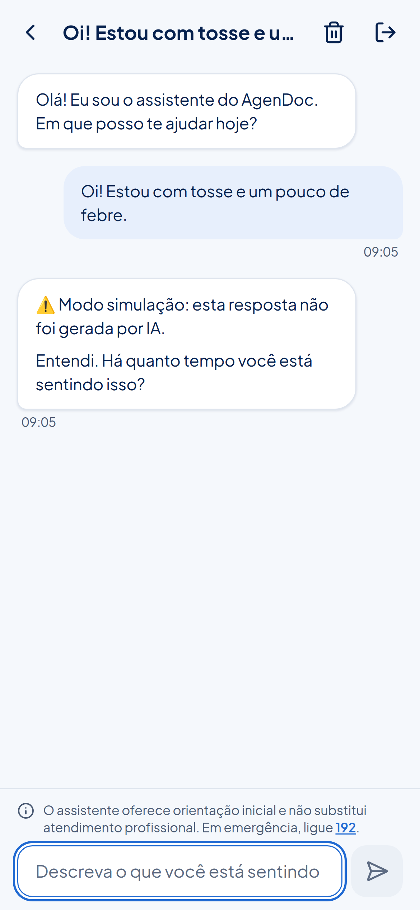</a>

Cada pessoa só vê as próprias conversas. Em produção o assistente usa um modelo de IA via OpenRouter, com um prompt em português que proíbe diagnóstico e prescrição.

## 3. Pré-triagem

Quando já tem informação suficiente, o assistente fecha a conversa com o **cartão de pré-triagem**:

- **Condição provável** (sempre como possibilidade, nunca "você tem X");
- **Especialidade indicada** (do catálogo de 15 especialidades);
- **Urgência**: baixa, média, alta ou emergência;
- **Recomendações básicas**;
- o aviso "Este resultado não é um diagnóstico";
- o botão **Agendar consulta**, que abre a busca já filtrada pela especialidade indicada.

  <a href="img/paciente/07-chat-triagem.png">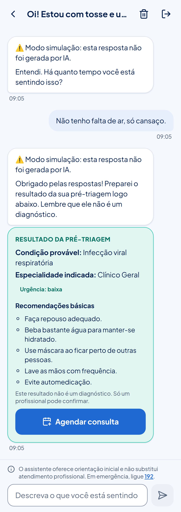</a>
  &nbsp;&nbsp;
  <a href="img/paciente/08-cartao-triagem.png">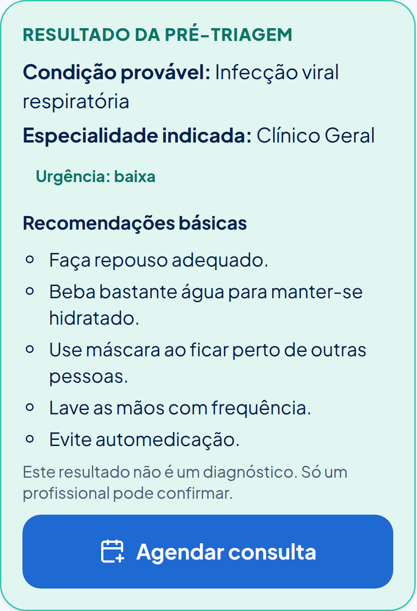</a>

A triagem também guarda um **resumo dos sintomas** (uma ou duas frases). Esse resumo só vai para a clínica se o paciente marcar a opção na hora de confirmar a consulta (veja o [passo 7](#7-confirmar-a-consulta)).

## 4. Emergência

Se a urgência for **emergência**, o cartão fica vermelho e **não oferece agendamento**. No lugar aparecem:

- o botão **Ligar para o SAMU (192)**;
- os **3 pronto atendimentos 24 h mais próximos**, com distância e link de rota direto para o Google Maps.

  <a href="img/paciente/09-emergencia.png">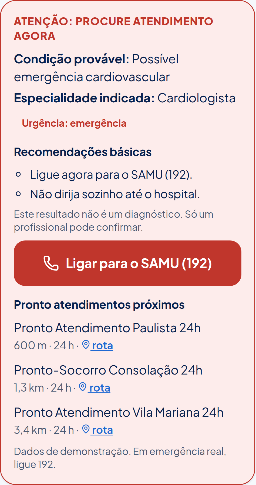</a>

## 5. Buscar clínicas

A busca abre com o **mapa primeiro** e a lista de clínicas deslizando por cima. Vindo do chat, ela já mostra o selo **"Indicado na pré-triagem: Clínico Geral"**.

- **Pins** no mapa com a nota e o próximo horário de cada clínica, e o pin **"Você"** com a localização da pessoa.
- **Filtros:** convênio, dia (hoje ou amanhã), período (manhã, tarde, noite), distância (até 5 km) e nota 4+.
- **Ordenação:** mais cedo, mais perto ou melhor nota.
- **Cartão da clínica:** nota e número de avaliações, distância, endereço, próximo horário, convênios aceitos e preço particular "a partir de".

  <a href="img/paciente/10-busca-mapa.png">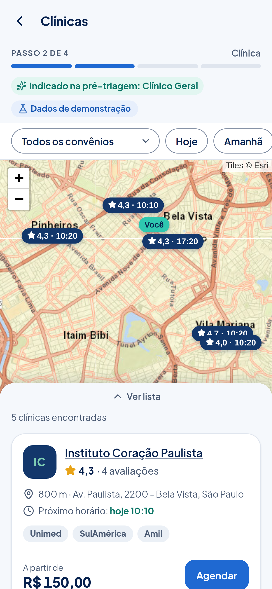</a>
  &nbsp;&nbsp;
  <a href="img/paciente/11-busca-lista.png">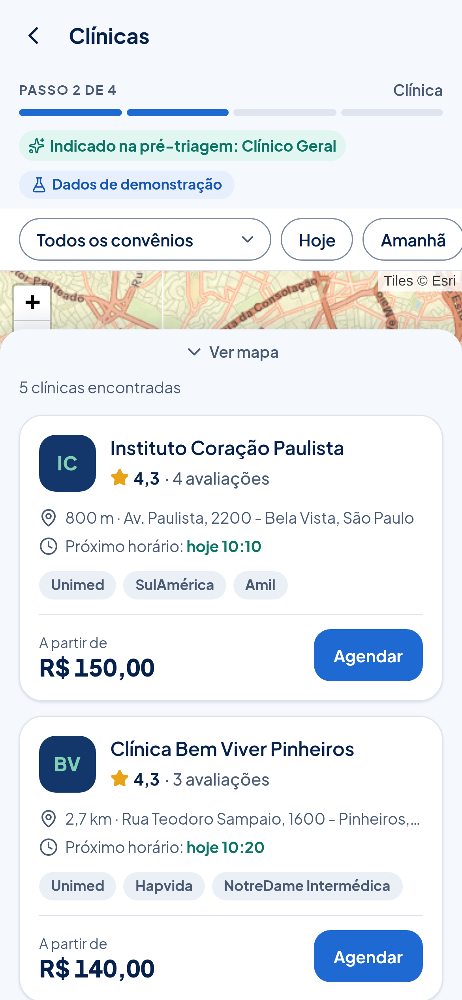</a>

A localização vem do navegador (com permissão). Se a pessoa recusar, o app usa o endereço do [Perfil](#14-perfil); sem nenhum dos dois, o mapa centraliza em São Paulo. O mapa usa Leaflet com os tiles da Esri e a lista funciona sozinha, sem o mapa.

## 6. Escolher clínica, dia e horário

A página da clínica mostra nota (com link para as avaliações), endereço, distância, preço particular e os botões **Ligar**, **WhatsApp** e **Rota**. Abaixo:

- uma **faixa de dias** (até 14 dias; fins de semana sem atendimento ficam desabilitados);
- os **horários livres de cada médico** da especialidade, com nome, CRM, duração e preço, separados em manhã, tarde e noite.

Ao tocar num horário, aparece o botão fixo **"Continuar · qui, 12 nov · 14:20"**.

  <a href="img/paciente/12-clinica.png">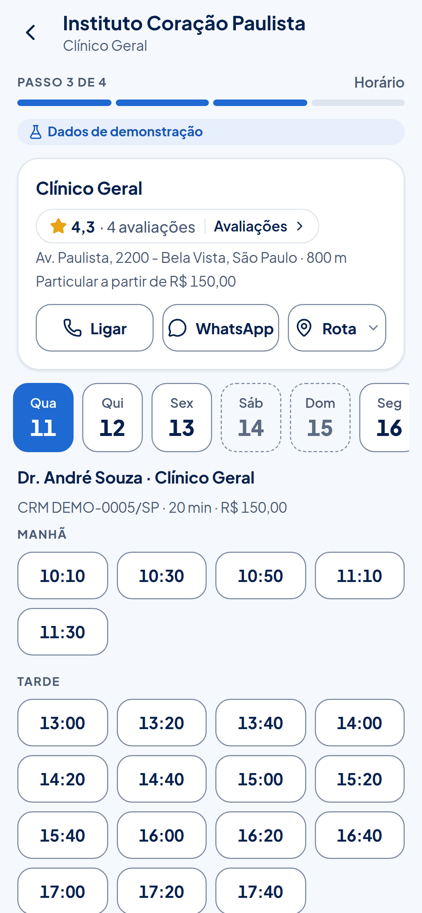</a>
  &nbsp;&nbsp;
  <a href="img/paciente/13-clinica-horario.png">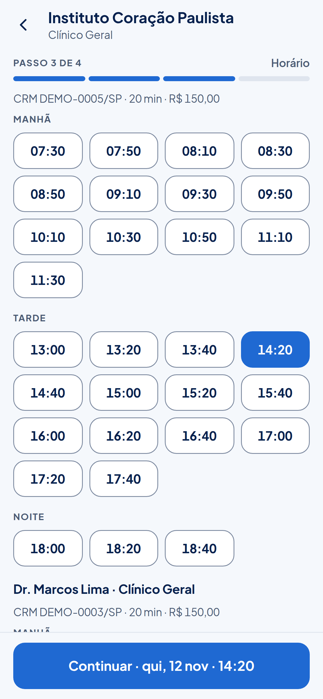</a>

Os horários livres são **calculados**: horários semanais do médico, menos bloqueios, menos consultas já marcadas.

## 7. Confirmar a consulta

A última etapa (passo 4 de 4) revisa tudo:

- **Resumo:** médico, clínica, data, hora, CRM, duração e endereço.
- **Pagamento:** convênio (só os que a clínica aceita, com carteirinha opcional) ou particular, com o valor.
- **Pré-triagem:** a caixa "Compartilhar o resumo da pré-triagem com a clínica" vem **desmarcada** (consentimento da LGPD). Vão só os sintomas relatados, a condição provável e a urgência; **a conversa nunca é enviada**.
- **Lembretes:** o Switch **Lembrete por e-mail** e, abaixo dele, os horários em que o lembrete chega: **1 semana**, **1 dia**, **2 h** e **1 h** antes. Dá para marcar mais de um; o padrão é **1 dia e 2 h**. Com o Switch ligado, é preciso escolher ao menos um. Horários que já teriam passado (ex.: "1 semana" numa consulta daqui a 3 dias) ficam desabilitados. O WhatsApp aparece como "Em breve".
- **Conta de teste:** aparece a linha "Conta de teste: você também recebe agora um exemplo do lembrete" (veja [E-mails](#15-e-mails)).
- O botão diz **"Confirmar agendamento"** (clínica automática) ou **"Solicitar horário"** (clínica manual).

  <a href="img/paciente/14-confirmar.png">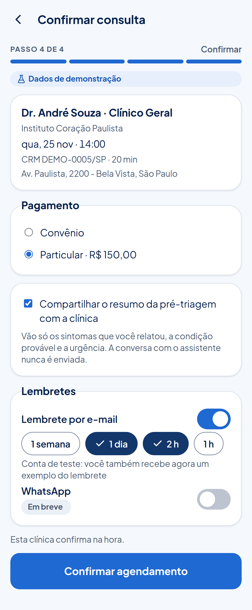</a>

A imagem é de uma conta de teste, numa consulta daqui a 9 dias: os quatro horários estão disponíveis e "1 dia" e "2 h" já vêm marcados.

Se outra pessoa pegar o mesmo horário no mesmo instante, a segunda recebe a mensagem de que o horário acabou de ser ocupado e a grade atualizada.

## 8. Consulta agendada ou aguardando a clínica

Depois de confirmar, a tela mostra:

- **"Consulta agendada"** (clínica automática) ou **"Aguardando a clínica"** com o prazo de resposta, por exemplo "Responde até qui 18:00" (clínica manual);
- **Adicionar à agenda** e **Como chegar**;
- **Antes da consulta:** as orientações fixas da clínica mais as recomendações da pré-triagem;
- **Se piorar:** sinais de alerta e o 192;
- **Pré-triagem que originou**, com link para a conversa;
- **Remarcar** e **Cancelar consulta**.

  <a href="img/paciente/15-confirmado.png">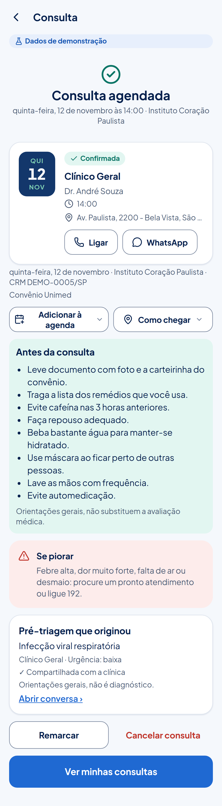</a>
  &nbsp;
  <a href="img/paciente/16-aguardando-clinica.png">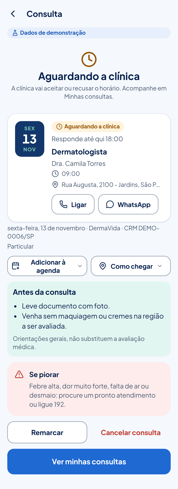</a>
  &nbsp;
  <a href="img/paciente/17-pedido-aceito.png">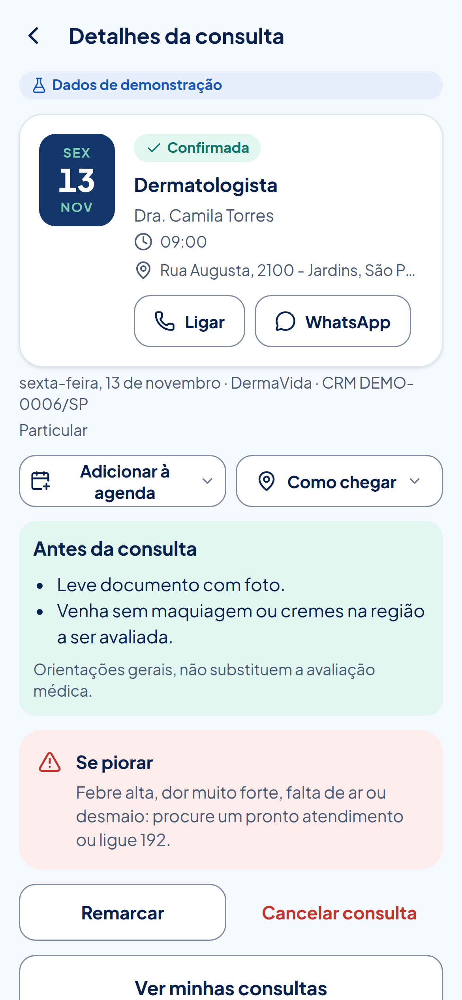</a>

Da esquerda para a direita: consulta confirmada na hora, pedido aguardando a clínica e o mesmo pedido depois que a clínica aceitou.

Ao mesmo tempo chega o e-mail **"Consulta marcada"** (ou **"Solicitação enviada"**, na clínica manual), com o resumo da pré-triagem quando a consulta veio do chat. Quando a clínica responde ao pedido, chega outro e-mail. Veja todos em [E-mails](#15-e-mails).

## 9. Minhas consultas

A aba **Consultas** tem duas partes:

- **Nova consulta:** atalhos por especialidade ("Ver todas as especialidades" mostra as 15), para quem quer marcar sem passar pelo chat.
- **Minhas consultas:** abas **Próximas** e **Anteriores**, com o selo de status em cada cartão e atalhos para "Como chegar" e "Remarcar".

  <a href="img/paciente/18-minhas-consultas.png">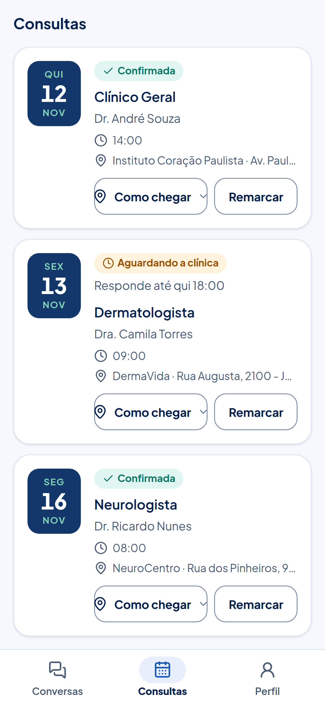</a>
  &nbsp;
  <a href="img/paciente/19-especialidades.png">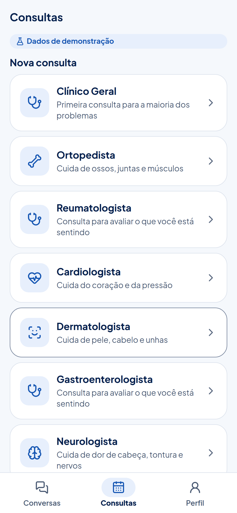</a>
  &nbsp;
  <a href="img/paciente/25-anteriores.png">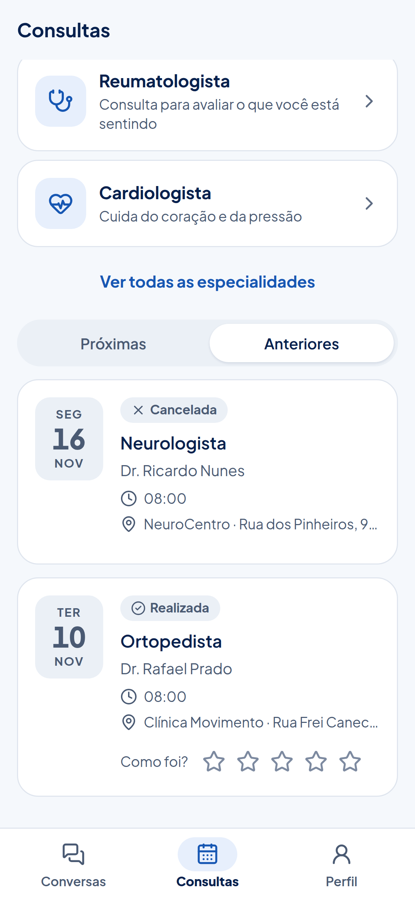</a>

Em **Anteriores**, a consulta realizada e ainda sem avaliação mostra as estrelas "Como foi?".

## 10. Adicionar à agenda e como chegar

- **Adicionar à agenda:** **Google Agenda** (abre o evento já preenchido, sem baixar arquivo) ou **iPhone, Outlook e outros** (arquivo `.ics`). A triagem nunca vai para o calendário.
- **Como chegar:** abre o app de mapas da pessoa (Google Maps ou Waze; Apple Mapas em iPhone e Mac), saindo da localização atual.

  <a href="img/paciente/20-adicionar-agenda.png">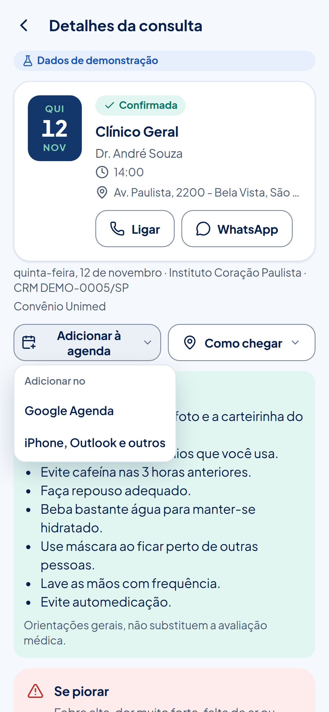</a>
  &nbsp;&nbsp;
  <a href="img/paciente/21-como-chegar.png">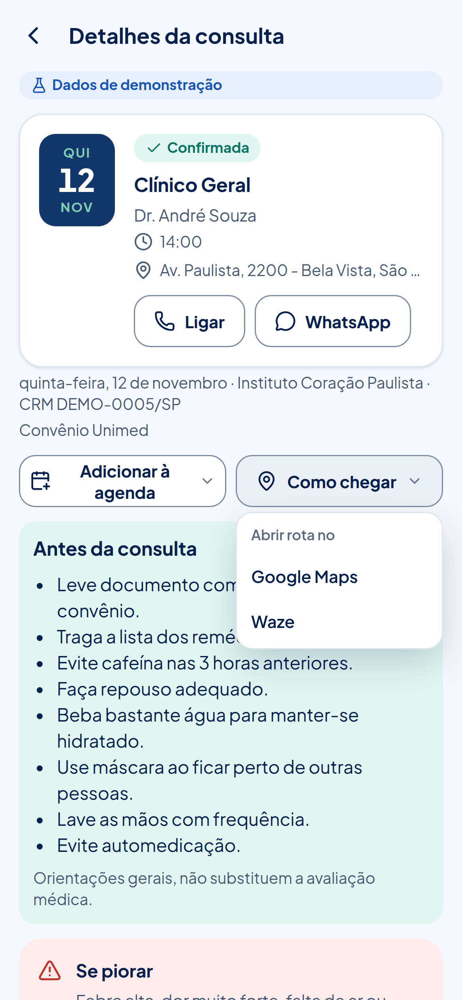</a>

## 11. Remarcar

Mostra o **horário atual** e a grade de horários da **mesma clínica e especialidade** (pode ser com outro médico). Trocar é uma operação só: se o novo horário falhar, o antigo continua valendo.

  <a href="img/paciente/22-remarcar.png">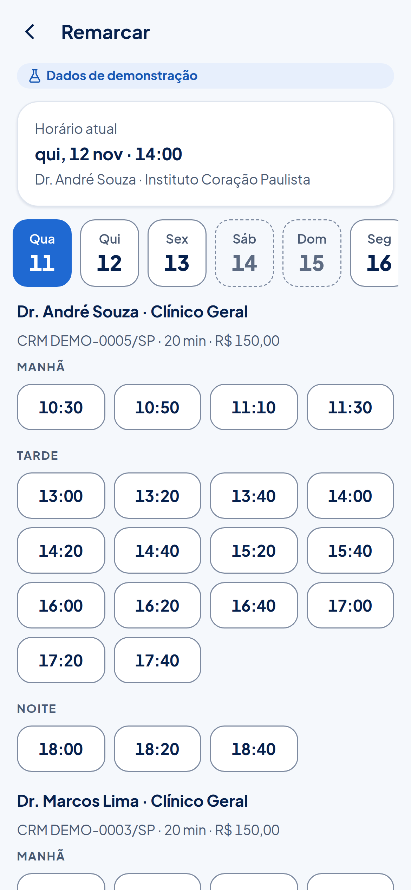</a>

Em clínica manual, o novo horário vira um pedido e o antigo **continua confirmado** até a clínica aceitar. Se ela recusar ou não responder, a consulta original continua valendo.

A remarcação manda o e-mail **"Consulta remarcada"**, com o horário anterior e o novo, e os lembretes escolhidos passam para o novo horário.

## 12. Cancelar

O cancelamento pede confirmação na própria tela ("O horário fica livre para outra pessoa"). Depois, a consulta aparece como **Cancelada** e vai para Anteriores.

  <a href="img/paciente/23-cancelar.png">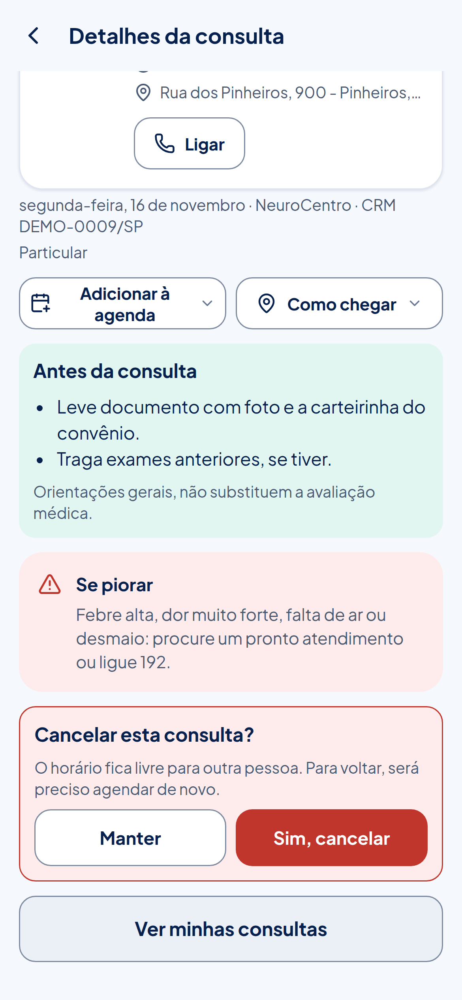</a>
  &nbsp;&nbsp;
  <a href="img/paciente/24-cancelada.png">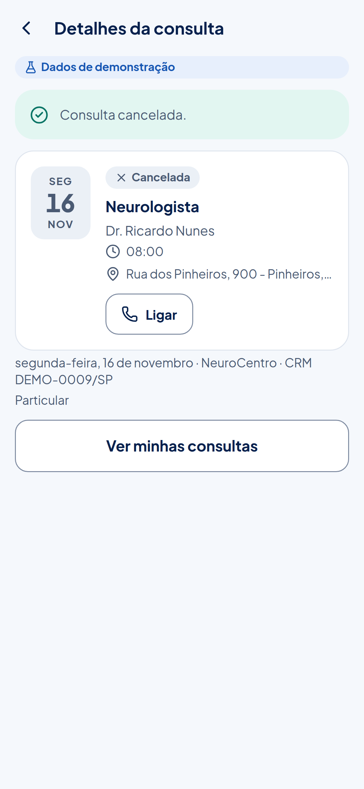</a>

Paciente só cancela ou remarca **até 2 h antes**. Depois disso, a tela orienta a falar com a clínica. Quando é a **clínica** que cancela, o paciente vê o motivo e o botão "Escolher novo horário".

## 13. Avaliar a consulta

Depois que a clínica marca a consulta como **realizada**, o paciente pode dar de **1 a 5 estrelas** e deixar um comentário opcional (até 500 caracteres). A avaliação é **anônima** ("Paciente verificado · mês/ano"), não pode ser editada e já entra na nota da clínica.

Na página da clínica, o link **Avaliações** mostra a média e os comentários.

  <a href="img/paciente/26-avaliar.png">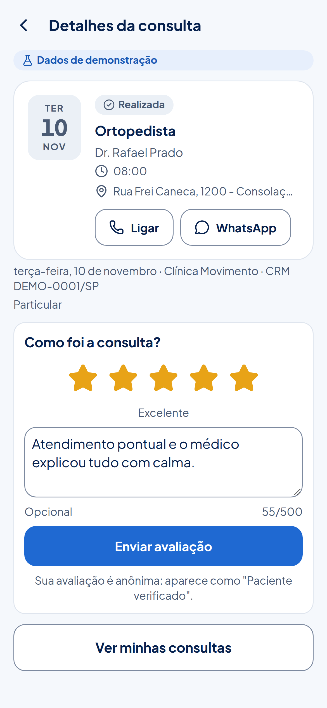</a>
  &nbsp;&nbsp;
  <a href="img/paciente/27-avaliacoes-clinica.png">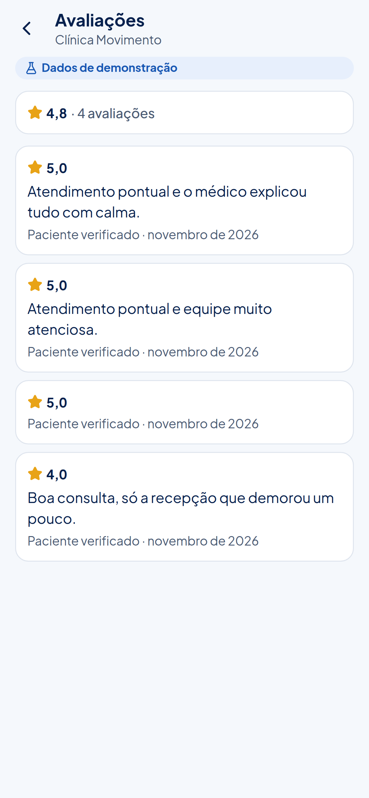</a>

## 14. Perfil

Nome (só leitura), **telefone**, **endereço** e **convênio** com o número da carteirinha.

- O endereço vira coordenadas no servidor (Nominatim/OpenStreetMap) e serve para medir distâncias quando a pessoa não compartilha a localização.
- O convênio salvo já vem escolhido na busca e na confirmação.
- O telefone aparece para a clínica nas consultas marcadas com ela.

  <a href="img/paciente/28-perfil.png">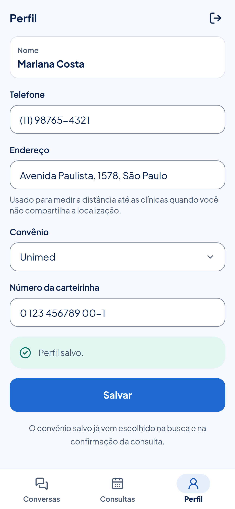</a>
  &nbsp;&nbsp;
  <a href="img/paciente/34-perfil-conta-teste.png">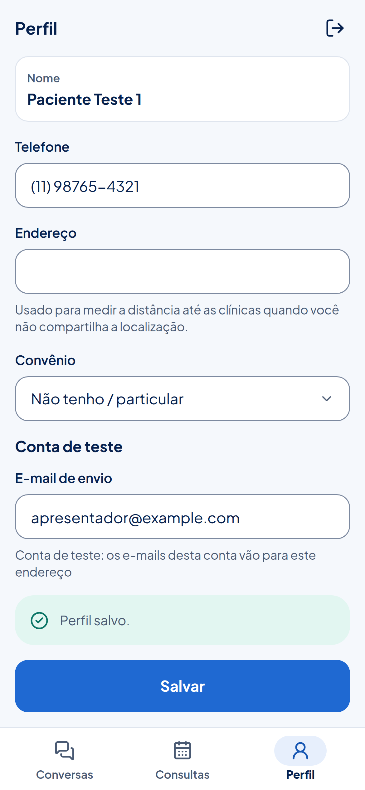</a>

**Só nas contas de teste** (`paciente1..3@demo.agendoc.dev`, imagem da direita) aparece a seção **Conta de teste** com o campo **E-mail de envio**: "os e-mails desta conta vão para este endereço". Como esses e-mails `@demo.agendoc.dev` não existem, é por esse campo que quem apresenta recebe os e-mails da conta (consultas, lembretes e o código de "Esqueci a senha") na própria caixa de entrada. Sem o campo preenchido, nada é enviado. O campo é opcional, não pede confirmação e **nunca aparece nem é aceito** para contas normais.

## 15. E-mails

O paciente recebe e-mails em pt-BR, nas cores do app, com o logo no topo e o botão **Ver consulta**, que abre a consulta no app. Contas normais recebem no e-mail do login; contas de teste, no "E-mail de envio". Em produção os e-mails saem da conta `agendoc.app@gmail.com`; localmente, ficam no Mailpit.

[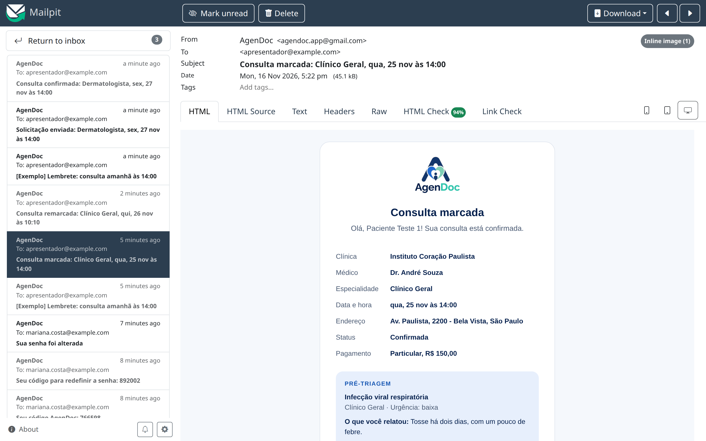](img/email/00-mailpit.png)

| E-mail | Quando chega |
|---|---|
| **Seu código AgenDoc: 123456** | No cadastro e a cada "Reenviar código" na tela Confirme seu e-mail |
| **Seu código para redefinir a senha: 123456** | Em "Esqueci a senha" |
| **Sua senha foi alterada** | Depois de trocar a senha |
| **Consulta marcada** ou **Solicitação enviada** | Ao marcar (clínica automática ou manual) |
| **Consulta remarcada** | Ao remarcar |
| **Consulta confirmada**, **Solicitação recusada**, **Solicitação expirada** ou **Consulta cancelada pela clínica** | Quando a clínica aceita ou recusa o pedido, quando o pedido expira sem resposta e quando a clínica cancela (com o motivo, também nos cancelamentos por [bloqueio](#6-bloqueios)) |
| **Lembrete: consulta amanhã às 14:00** | Nos horários escolhidos na confirmação, só se a consulta ainda estiver confirmada |
| **[Exemplo] Lembrete: ...** | Na hora em que uma conta de teste marca a consulta com o lembrete ligado |

Os códigos aparecem numa caixa destacada e valem 15 minutos:

  <a href="img/email/01-codigo-confirmacao.png">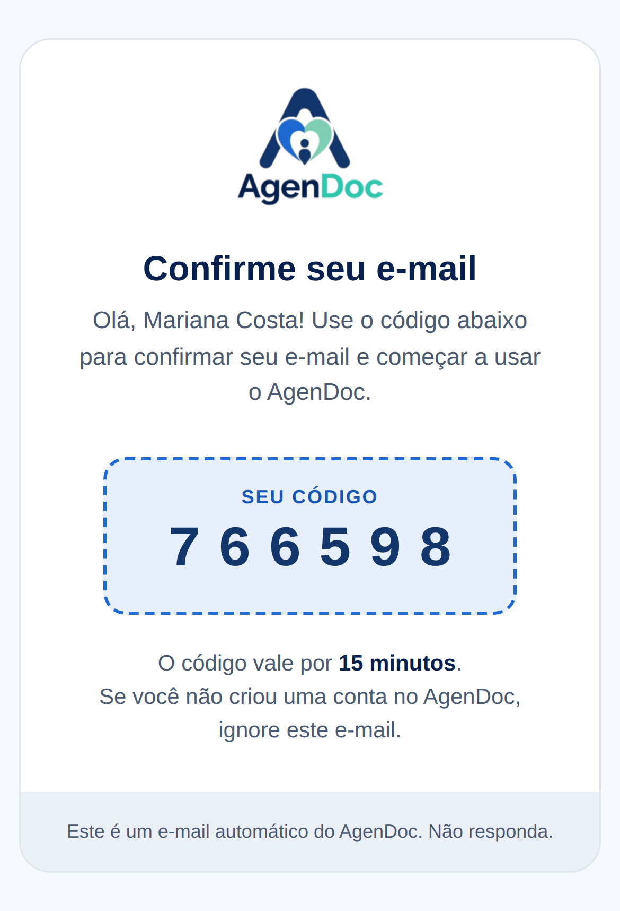</a>
  &nbsp;&nbsp;
  <a href="img/email/02-codigo-senha.png">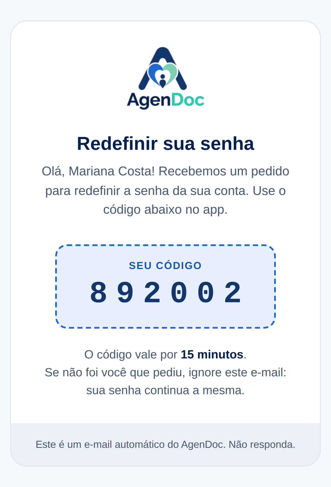</a>

O e-mail **Consulta marcada** traz clínica, médico, especialidade, data e hora, endereço, status e pagamento. Se a consulta veio do chat, traz também a **pré-triagem**: condição provável, especialidade, urgência, o resumo do que a pessoa relatou e as recomendações. Esse resumo vai para o próprio paciente mesmo que ele não tenha compartilhado com a clínica; a conversa nunca vai. No fim vêm os sinais de alerta ("Se piorar"), o 192 e o aviso de que são orientações gerais, que não substituem a avaliação médica.

  <a href="img/email/03-consulta-marcada.png">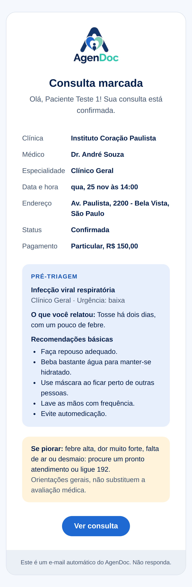</a>

O **lembrete** tem data e hora, clínica, endereço, link **Ver rota no mapa** e a orientação de chegar com antecedência. Nas contas de teste, ao marcar, chega na hora um **exemplo** do primeiro lembrete escolhido, com "[Exemplo]" no assunto e a faixa "Exemplo: é assim que você receberá o lembrete 1 dia antes da consulta". Assim dá para mostrar o lembrete numa apresentação sem esperar um dia. Os lembretes de verdade continuam agendados.

  <a href="img/email/04-lembrete-exemplo.png">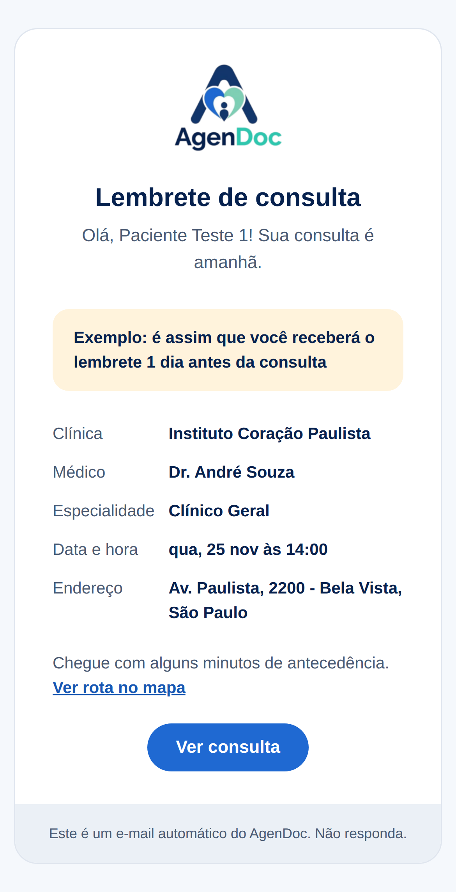</a>
  &nbsp;
  <a href="img/email/05-remarcada.png">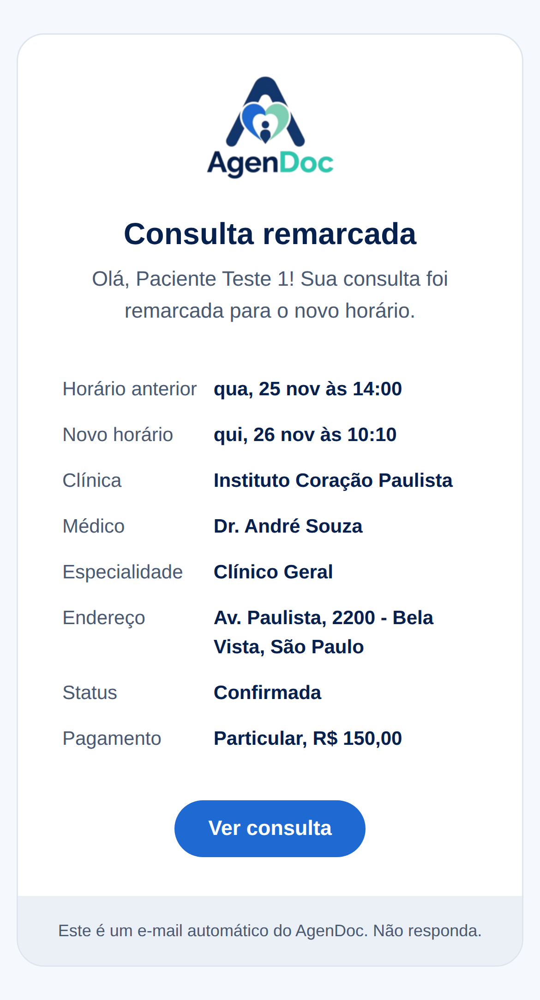</a>
  &nbsp;
  <a href="img/email/06-clinica-aceitou.png">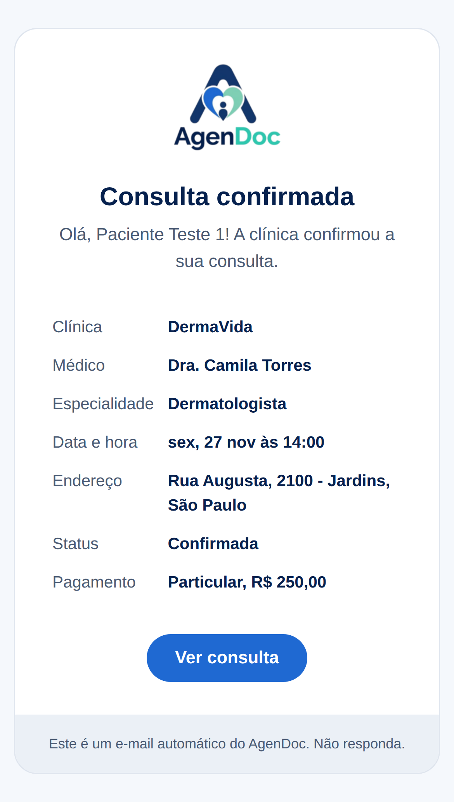</a>

Da esquerda para a direita: o exemplo do lembrete, a remarcação (horário anterior e novo) e a resposta da clínica DermaVida (manual) aceitando o pedido. A clínica não recebe e-mails nesta parte.

> Nas imagens, o assistente estava em modo simulação, por isso o "relato" no e-mail não bate com as mensagens da conversa.

---

# Clínica

O painel fica em `/clinica`, com menu lateral: Agenda, Solicitações, Médicos, Horários de atendimento, Bloqueios, Dados da clínica e Avaliações. A clínica só vê os próprios dados e só vê dados de pacientes que marcaram consulta com ela. **Nunca vê o chat do paciente.**

## 1. Agenda

A semana inteira numa grade, com uma cor por médico. Dá para filtrar por médico, andar entre semanas e voltar para hoje. A legenda explica os estados: confirmada, aguardando você, prazo vencido, remarcação, livre, fechado e bloqueado.

[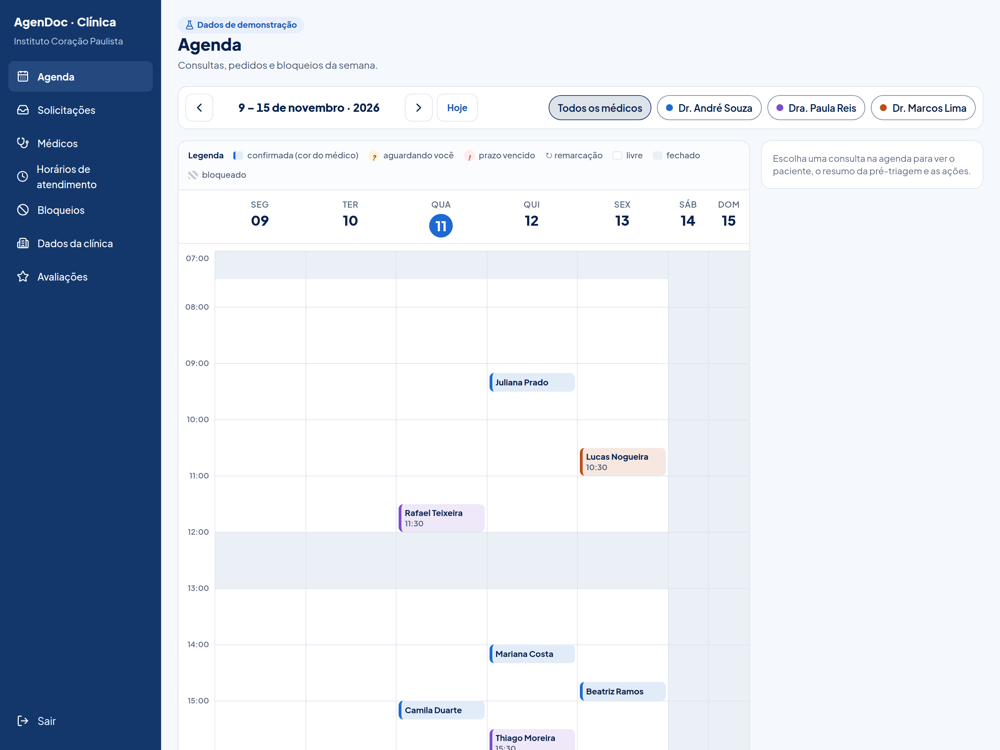](img/clinica/01-agenda.png)

## 2. Detalhe da consulta

Ao clicar numa consulta, o painel da direita mostra o paciente (nome, telefone com Ligar e WhatsApp, convênio e carteirinha), o médico, o horário e, **se o paciente compartilhou**, o resumo da pré-triagem com o aviso "Gerado por IA, não é diagnóstico".

[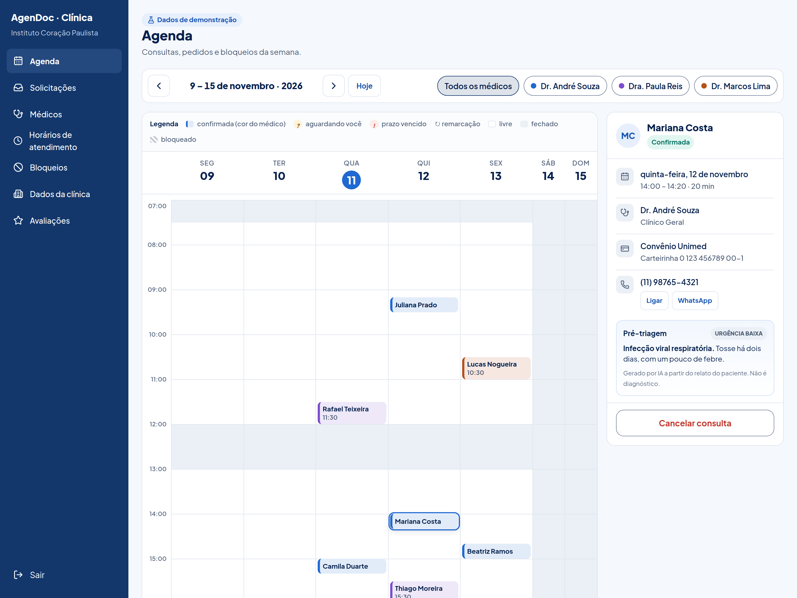](img/clinica/02-detalhe-consulta.png)

Ações disponíveis:

- **Cancelar consulta** (antes do horário, com motivo obrigatório, que o paciente vê no app e recebe por e-mail);
- **Marcar como realizada** ou **Faltou** (só depois que a consulta começou).

[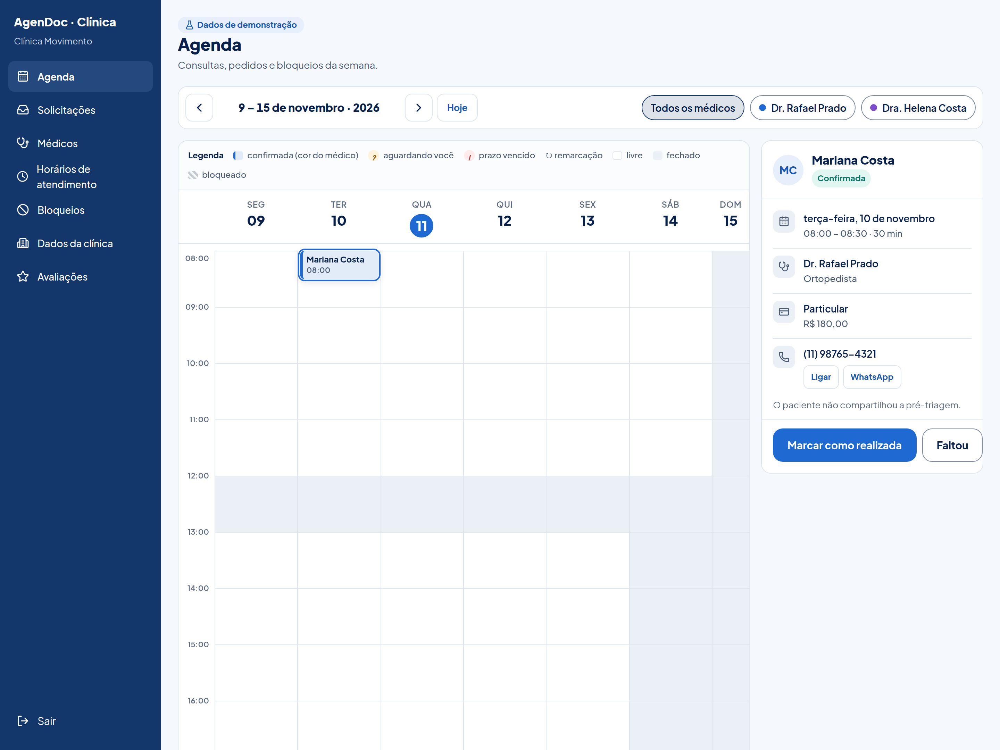](img/clinica/03-marcar-realizada.png)

## 3. Solicitações

Só aparece movimento aqui nas clínicas com **confirmação manual**. É a lista de pedidos de horário e de remarcação que esperam resposta, com o prazo de cada um. O menu mostra quantos estão aguardando.

[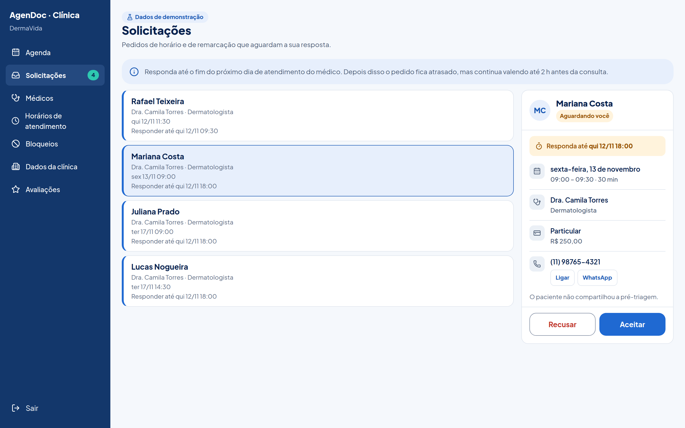](img/clinica/04-solicitacoes.png)

Aceitar, recusar ou deixar o pedido expirar manda um e-mail para o paciente ([E-mails](#15-e-mails)). O mesmo vale quando a clínica cancela uma consulta: o paciente recebe o motivo por e-mail.

Regra do prazo: a clínica deve responder **até o fim do próximo dia de atendimento do médico**. Depois disso o pedido fica "atrasado" (com destaque vermelho), mas ainda pode ser aceito. Ele só **expira 2 h antes da consulta**. Assim, um pedido feito na sexta à noite não se perde no fim de semana.

## 4. Médicos

Lista dos médicos com CRM, situação (ativo ou inativo), especialidades e carga semanal. Cada médico pode ter **de 1 a 5 especialidades**, cada uma com **duração e preço particular próprios** (ex.: Cardiologista 30 min por R$ 300,00 e Clínico Geral 20 min por R$ 150,00).

[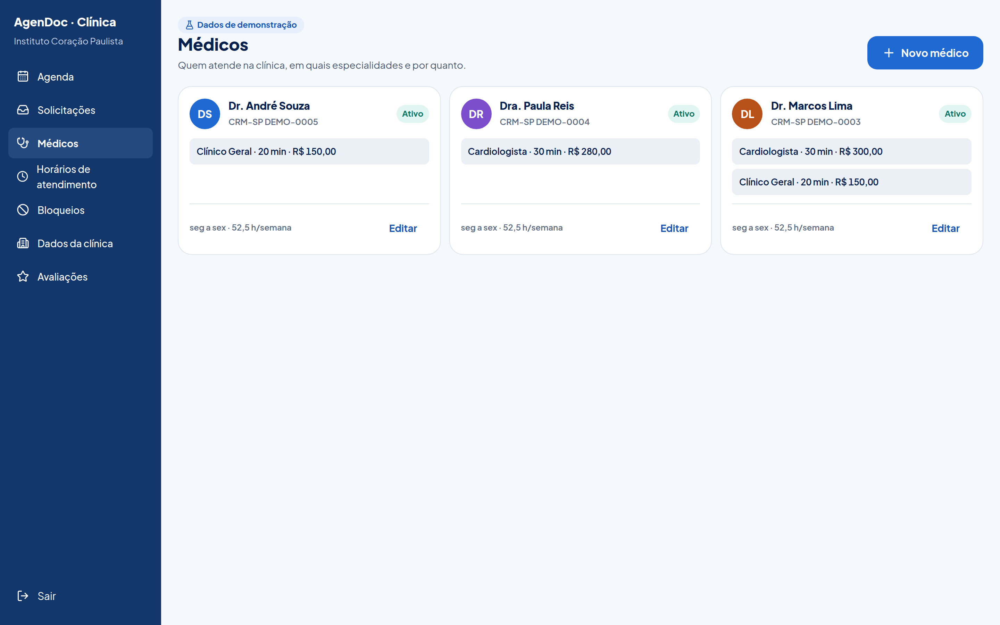](img/clinica/05-medicos.png)

[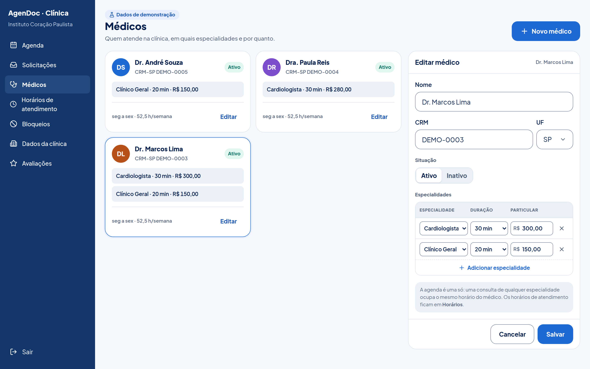](img/clinica/06-medico-editar.png)

A agenda do médico é uma só: consultas de especialidades diferentes nunca se sobrepõem. Desativar um médico tira ele da busca, mas não apaga as consultas.

## 5. Horários de atendimento

Os horários semanais de cada médico: um ou mais períodos por dia (ex.: 07:30 às 12:00 e 13:00 às 19:00), com uma "visão do dia" em barras. Há atalhos para **copiar segunda para os dias úteis** e **limpar a semana**, e um resumo com dias, horas por semana, primeiro e último horário.

[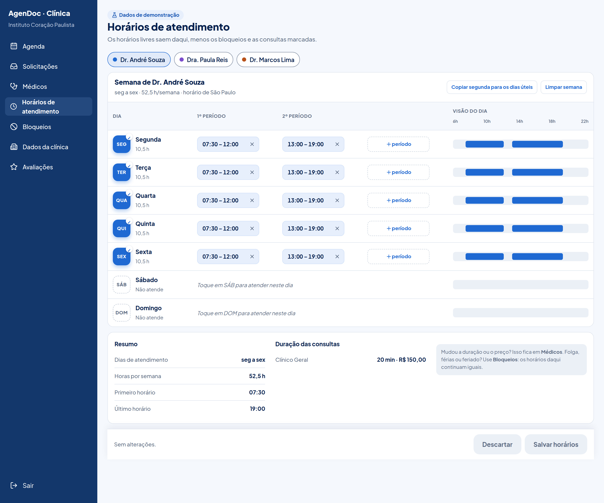](img/clinica/07-horarios.png)

Os horários livres que o paciente vê saem daqui, menos os bloqueios e as consultas marcadas.

## 6. Bloqueios

Folgas, férias, feriados, congressos e reuniões. O bloqueio vale para a **clínica inteira** ou para **um médico**, por dias inteiros ou por um intervalo de horas. A lista separa próximos e passados.

Se o período cair sobre consultas já marcadas, o formulário avisa quantas são e quem são, e oferece **cancelar todas e avisar os pacientes** com um motivo.

## 7. Dados da clínica

O que os pacientes veem na busca e na consulta:

- **Contatos:** telefone e WhatsApp;
- **Convênios aceitos** (particular é sempre aceito);
- **Como os pedidos são confirmados:** automática (confirma na hora) ou "a clínica confirma" (vira pedido em Solicitações);
- **Orientações para o paciente** antes da consulta (até 10, em ordem).

Nome, endereço e localização no mapa são definidos pela equipe do AgenDoc.

## 8. Avaliações

Somente leitura: a nota média, o total e os comentários, **anônimos** como o paciente vê.

---

## Regras importantes

| Regra | Como funciona |
|---|---|
| Janela para marcar | De agora + 1 h até 30 dias à frente. Em clínica manual, o primeiro horário oferecido fica pelo menos 4 h de expediente depois do pedido |
| Cancelar e remarcar (paciente) | Até 2 h antes da consulta |
| Limites por paciente | No máximo 5 consultas ativas e 10 ações (marcar, remarcar, cancelar) por hora |
| Horário duplicado | Impossível: a garantia fica no banco (trava por médico), não só na tela |
| Consultas sobrepostas | A mesma pessoa não pode ter duas consultas ativas no mesmo horário, nem em clínicas diferentes |
| Pedido sem resposta | Fica "atrasado" depois do prazo e só expira 2 h antes da consulta |
| Consulta que já passou | Aparece como "Encerrada" até a clínica marcar realizada ou falta |
| Avaliação | Só de consulta realizada, só pelo próprio paciente, uma vez, anônima |
| Pré-triagem para a clínica | Só com o consentimento marcado na confirmação; vai uma cópia do resumo, nunca o chat |
| Confirmação do e-mail | Paciente não confirmado fica preso na tela Confirme seu e-mail até digitar o código |
| Códigos (confirmação e senha) | 6 dígitos, valem 15 min, até 5 tentativas erradas; reenvio a cada 60 s, no máximo 5 por hora. Um código novo invalida o anterior |
| Esqueci a senha | Nunca revela se o e-mail tem conta; trocar a senha encerra todas as sessões |
| E-mail de envio | Só para as contas de teste; contas normais nunca veem nem podem salvar o campo |
| Lembretes | Só para consulta confirmada; cada um sai no máximo uma vez; um lembrete atrasado mais de 10 min (ex.: API fora do ar) é pulado, nunca enviado atrasado |
| Falha de e-mail | Nunca impede cadastrar, marcar, remarcar ou responder um pedido: o e-mail sai depois, em segundo plano |
| Isolamento | Paciente só vê o que é dele; clínica só vê o que é dela. Recurso de outro dono responde 404 |
| Fuso | Tudo exibido em horário de São Paulo e guardado em UTC |

## Bastidores

Coisas que não têm tela, mas fazem parte do que foi entregue:

- **Criação de clínicas:** endpoint de admin (`POST /api/admin/clinics`, documentado no Swagger), que cria a clínica e o login dela e devolve a senha inicial uma única vez. Não há tela de admin.
- **Dados de demonstração:** 12 clínicas fictícias em São Paulo (Paulista, Pinheiros e Vila Mariana), cobrindo as 15 especialidades, mais 4 pronto atendimentos 24 h e avaliações iniciais. CRMs no formato `DEMO-0000` para não parecerem reais.
- **Contas de teste de paciente:** o seed cria `paciente1..3@demo.agendoc.dev` (já confirmadas) quando `DEMO_PATIENT_PASSWORD` está definida, mesmo num banco que já tem clínicas.
- **Expiração automática:** um job muda para "Expirou" os pedidos não respondidos até 2 h antes da consulta e avisa o paciente por e-mail.
- **Lembretes:** uma tarefa roda a cada minuto e envia os lembretes cujo horário chegou. Cada lembrete guarda o canal (hoje só e-mail).
- **Envio de e-mail:** SMTP configurado por variáveis de ambiente. Em produção, Gmail (`agendoc.app@gmail.com`, porta 587, senha de app só no `.env` da VM); localmente, o Mailpit do `compose.yaml`.
- **Stack:** API em Java 21 + Spring Boot 4 + MySQL ([`agendoc-api`](https://github.com/Agendoc/agendoc-api)) e web em Next.js 16 + React 19 ([`agendoc-web`](https://github.com/Agendoc/agendoc-web)). O contrato completo da API está no README da API e no Swagger.
- **Deploy:** merge na `main` dispara o CI, que publica na VM sozinho. Detalhes em [`agendoc-api/docs/deploy.md`](https://github.com/Agendoc/agendoc-api/blob/main/docs/deploy.md).
- **Mais detalhes de produto:** [spec da Parte 1](../specs/2026-11-01-clinics-scheduling-design.md), [redesenho do painel](../specs/2026-11-08-clinic-panel-v2-design.md), [spec da Parte 2](../specs/2026-11-09-email-design.md) e [roadmap](../roadmap.md).
